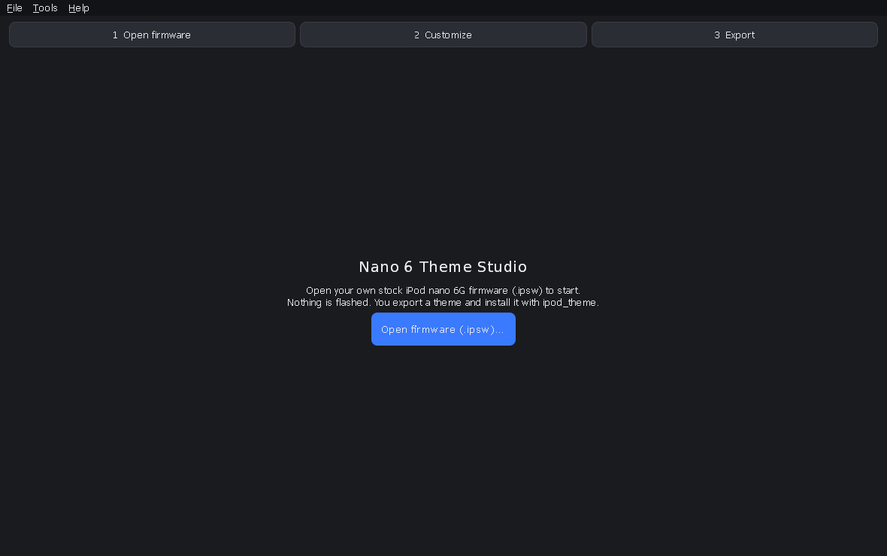
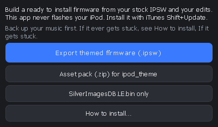
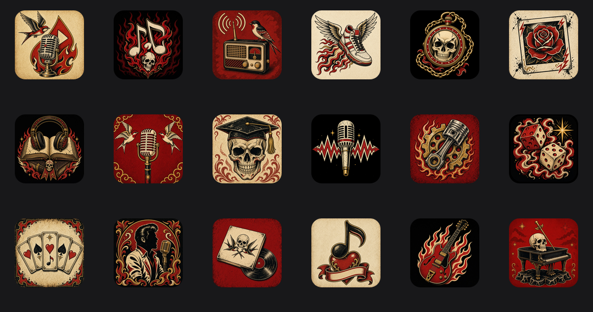

# Nano 6 Theme Studio

A Windows theme editor for the **iPod nano 6th generation** (firmware 1.2, 36B10147).
Replace home-screen icons, clock faces with their hands, and wallpapers, see the result in a
live 240×240 preview, and export a ready-to-install themed IPSW.

* **No Apple firmware is included.** You open your own stock IPSW.
* **The app never writes to your iPod.** It produces a file; you install it with iTunes.
* Free software under the GNU GPL v3, built on community work by ipod_theme, ipod_sun,
  ipodhax, silverutil and others (see [Credits](#credits)).




Screenshots of the editor itself are not included because they show Apple's stock artwork.
The sample art below is original:



## Features

- Opens a stock nano 6G IPSW: MSE container → rsrc FAT16 volume → SilverImagesDB, all in memory
- Home Icons, Clock Faces and Wallpapers tabs (and every image under Advanced)
- Live home and clock preview; before/after, replace and revert per image
- Framing editor: fill/fit, pan, zoom, rotate, brightness/contrast/saturation
- Recolour: tint, replace colour with an eyedropper, hue shift; recolour all icons at once
- AI prompt helper: copy a prompt for your AI image tool, import the sheet back, and it is split
  and applied automatically
- Two sample themes in `samples/` (open them with File → Open theme project… after loading firmware)
- Save/load `.n6theme` projects; export a themed IPSW, the SilverImagesDB, or an asset pack
- A validator blocks the export on any structural problem in the image database
- Built-in install guide with backup and recovery steps

### Colour tools, clock hands and AI prompts
- Image editor > Recolour: Tint/Colourize (colour + Strength), Replace colour (Pick from image eyedropper, target colour, Tolerance), Hue shift. Live preview, alpha preserved, Cancel reverts.
- Home Icons tab > Recolour all home icons...: same tint/hue applied to all 18 apps (live preview, Cancel reverts).
- Clock backgrounds: "Show clock hands" (on by default) draws the face's hands in semi-transparent cyan, pivoting at the screen centre, in the editor and the live preview; the live preview follows the editor while it is open and switches to Clock view on the Clock Faces tab. Digit/date glyphs are static (drawn by the OS at per-face positions), so they are not overlaid and not editable from the Clock Faces tab (Advanced: all images still lists them).
- AI prompt…: pick Everything, Just icons, Just backgrounds or Watch face + hands, set a Style, Copy prompt, then Import… one sheet or several images; they are split and applied automatically (a review step appears only when the match is uncertain).


## Safety and recovery

Installing modified firmware is at your own risk. Upstream ipod_sun warns that bad packs
**can and have** bricked devices. Nano 6 Theme Studio reduces the risk (an unedited rebuild is
byte-identical to stock, every export is validated, and home icons, clock faces and
wallpapers were tested on a real nano 6G) but cannot remove it.

Before you install:

1. Keep your stock `iPod_1.2_36B10147.ipsw`. Apple still hosts it:
   `https://secure-appldnld.apple.com/iPod/SBML/osx/bundles/041-1920.20111004.CpeEw/iPod_1.2_36B10147.ipsw`
2. Back up the iPod: with hidden items shown, copy the whole drive, including `iPod_Control`.

**If it shows "OK to disconnect" in black and white** (normal after a restart or flat battery):
hold Volume Down + Sleep/Wake until the Apple logo, release Sleep/Wake, keep Volume Down and
also hold Volume Up until the Home screen appears.

**If it is stuck or keeps restarting: restore stock firmware (recovery/DFU mode)**

1. Charge it on the PC for 10–15 minutes.
2. Use a rear USB port with the Apple cable and open iTunes.
3. Hold Volume Down + Sleep/Wake through the Apple logo until the screen goes black,
   then 1–2 seconds more, and let go. The screen stays black.
4. iTunes reports an iPod in recovery mode. (If iTunes shows an error you held too long; retry.)
5. Hold Shift, click **Restore iPod**, and choose the stock `iPod_1.2_36B10147.ipsw`.
6. This erases the iPod. Copy your backup back afterwards.

If iTunes does not see it at all, reinstall iTunes (this reinstalls the Apple Mobile Device
USB driver) and try another cable, port or PC. Deeper recovery research lives at
[freemyipod](https://freemyipod.org/) and [wInd3x](https://github.com/freemyipod/wInd3x).

## Getting the firmware (iPod_1.2_36B10147)

The app does not include Apple's firmware. You supply your own copy. The file
you want is the stock IPSW for the **iPod nano 6th generation**, firmware
**1.2**, build **36B10147**, named `iPod_1.2_36B10147.ipsw`.

Apple still hosts that exact file:

https://secure-appldnld.apple.com/iPod/SBML/osx/bundles/041-1920.20111004.CpeEw/iPod_1.2_36B10147.ipsw

The file is 112,554,060 bytes. Checksums:

* SHA-1: `14f204204ed0c2236fdd935ccfa2ee6204cb5feb`
* SHA-256: `84b27d59f376eaf51270f2ee7ee67016e67fc992882d518f9b294ee21122297d`

On the iPod, open **Settings > General > About** to see the version. You want
1.2 (build 36B10147).

iTunes on Windows may already have cached it under
`%APPDATA%\Apple Computer\iTunes\iPod Software Updates`. Look there for
`iPod_1.2_36B10147.ipsw` before downloading it again. Keep the original
somewhere safe; the recovery steps above use the same file.

## Install guide

1. **Open firmware** and edit icons, clock faces and wallpapers.
2. **Export → Themed firmware (.ipsw)**. It saves `iPod_1.2_36B10147_themed.ipsw`.
3. Back up your music (see above).
4. Plug the iPod into a rear USB port and open iTunes. Click the iPod icon.
5. **Hold Shift and click Check for Update** (not Restore), choose the themed IPSW, click Update.
6. Wait until the iPod restarts to the Home screen before unplugging.

The same guide is in the app under **Export → How to install…**.

## Running from source

```bash
python -m venv .venv
. .venv/bin/activate            # Windows: .venv\Scripts\activate
pip install -r requirements.txt
PYTHONPATH=src python -m nano6studio
```

## Building the Windows .exe

PyInstaller with the included `Nano6ThemeStudio.spec` (on Windows, or under Wine with a
Windows Python 3.11; see `scripts/build_windows.sh`). The build is about 20 MB. A headless
check: `Nano6ThemeStudio.exe --selftest <fw.ipsw> <report.txt> [theme.n6theme] [shots_dir]`.

## Tests

```bash
pip install pytest
QT_QPA_PLATFORM=offscreen PYTHONPATH=src pytest -q                    # firmware tests skip
NANO6_IPSW=/path/to/iPod_1.2_36B10147.ipsw QT_QPA_PLATFORM=offscreen PYTHONPATH=src pytest -q
```

Most tests need the stock firmware, which cannot be redistributed. Set `NANO6_IPSW` to your
own copy; without it those tests are skipped. The upstream comparison test also needs
`pip install pyfatfs`.

## Contributing

See [CONTRIBUTING.md](CONTRIBUTING.md). Please never commit Apple firmware or images extracted
from it (`.ipsw`, `.MSE`, `SilverImagesDB*`, stock PNGs or fonts).

## Project layout

```
src/nano6studio/
  __main__.py          entry point (GUI, or --selftest)
  shots.py             headless self-test and screenshots
  core/                firmware and theme logic, no Qt
    mse.py             Firmware.MSE sections (directory at 0x5000)
    fat16.py           minimal FAT12/16 reader/writer
    rsrc_fs.py         SilverImagesDB.LE.bin inside the rsrc FAT16 volume
    firmware_pack.py   build and verify a themed IPSW (port of ipod_sun's repack)
    silverimages.py    SilverImagesDB decode/encode (byte-identical to ipodhax)
    validate.py        pre-export checks; any problem blocks the IPSW build
    loader.py          IPSW -> MSE -> rsrc -> SilverImagesDB + catalog
    catalog.py         which image is which: icons, clock faces, wallpapers
    project.py         theme project (.n6theme) and edit tracking
    icons.py           write one artwork into every bitmap of an app
    home_render.py     240x240 home screen / clock renderer for previews
    cropper.py         framing maths shared by the editor and importers
    recolor.py         tint, replace colour, hue shift
    ai_prompts.py      AI prompt text and sheet/file matching
    sheet_detect.py    find tiles on an AI-generated sheet
    export.py          asset pack and install guide export
  ui/                  PySide6 widgets
    main_window.py     tabs, live preview, detail panel
    preview.py         live 240x240 device preview
    editor.py          framing/colour editor dialog
    ai_dialog.py       AI prompt window and import
    recolour_all.py    recolour all home icons
    install_wizard.py, credits.py, styles.py, qtutil.py
scripts/               build script and sample theme generators
samples/               Rock Theme and Phosphor Terminal sample projects and source art
tests/                 pytest suite (tests/upstream holds the ipodhax reference code)
docs/                  format notes and device verification
```

Format notes: [docs/UPSTREAM_COMPARE.md](docs/UPSTREAM_COMPARE.md) and
[docs/WALLPAPERS.md](docs/WALLPAPERS.md).

## Credits

Nano 6 Theme Studio by sharphatman-ux. It would not exist without:

- **[ipod_theme](https://github.com/nfzerox/ipod_theme)** by nfzerox with TGRgitx, CUB3D and
  unknown321 (GPL-3.0). The themed-IPSW export is a Python port of its nano 6G repack.
- **[ipod_sun](https://github.com/CUB3D/ipod_sun)** by CUB3D (GPL-3.0), the base of ipod_theme.
- **[ipodhax](https://github.com/760ceb3b9c0ba4872cadf3ce35a7a494/ipodhax)** by
  760ceb3b9c0ba4872cadf3ce35a7a494 (MIT): SilverImagesDB/MSE/IMG1 formats; parts of the encoder
  are adapted from it, and it is vendored unmodified as the test reference.
- **[silverutil](https://github.com/spotlightishere/silverutil)** by Spotlight (MIT).
- **[ipod_theme_testing_changes](https://github.com/TGRgitx/ipod_theme_testing_changes)** by TGRgitx,
  **[wInd3x](https://github.com/freemyipod/wInd3x)** by q3k / freemyipod,
  **[S5Late](https://github.com/m-gsch/S5Late)** by m-gsch,
  **[S5Late-8723](https://github.com/NyanSatan/S5Late-8723)** by NyanSatan,
  the **[freemyipod](https://freemyipod.org/)** community,
  **[Asset Replacer](https://assetreplacer.zeehondie.net/)** by Zeehondie and
  **[NanoVault](https://github.com/g0lder/NanoVault)** by g0lder.

Full details: [CREDITS.md](CREDITS.md). Library licences: [THIRD_PARTY_LICENSES.md](THIRD_PARTY_LICENSES.md).
The same credits are in the app under **Help → About / Credits**.

## Licence and trademarks

GNU General Public License v3.0 only ([LICENSE](LICENSE)), because the IPSW builder is ported
from GPL-3.0 code. Ported and vendored code keeps its original licence; see `third_party/`.

The sample themes ("Rock Theme" and "Phosphor Terminal") are original art with no logos and
are not affiliated with or endorsed by any band, game or brand. Apple, iPod, iPod nano and iTunes
are trademarks of Apple Inc. All other trademarks belong to their respective owners. This is an
independent project, not affiliated with or endorsed by Apple or any other trademark owner.
